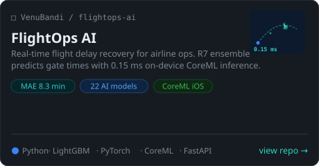
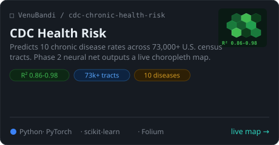
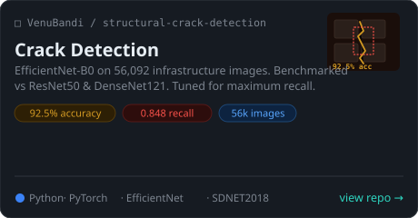
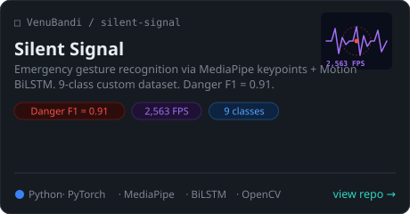
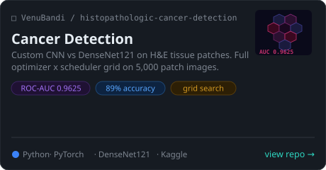
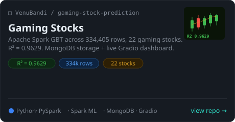
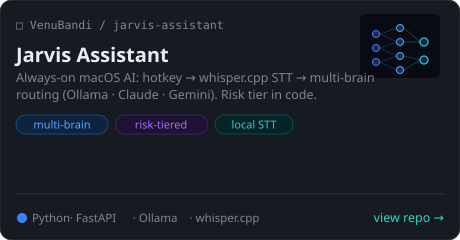
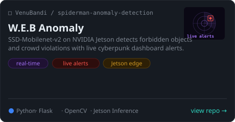

# Venu Bandi

MS Data Science · UMBC

---

**Stack**

---

## Currently Building

<table>
<tr>
<td>

### ✈️ [FlightOps AI](https://github.com/VenuBandi/flightops-ai)

Real-time flight delay recovery decision support for airline operations — built for dispatchers who need actionable answers in under a second.

| Metric | Result |
|:--|:--|
| Prediction accuracy | MAE **8.3 min** |
| On-device inference | **0.15 ms** CoreML |
| AI models integrated | **22** across 7 providers |
| Airlines covered | F9 · UA · WN |
| Training data | 2023–2025 BTS (federal) |

R7 ensemble · LGB + Neural · Conformal prediction intervals · iOS app

`LightGBM` `PyTorch` `CoreML` `FastAPI` `Supabase` `PySpark`

</td>
</tr>
</table>

---

## Featured Projects

  
  
  
  
  
  
  
  

---

  

